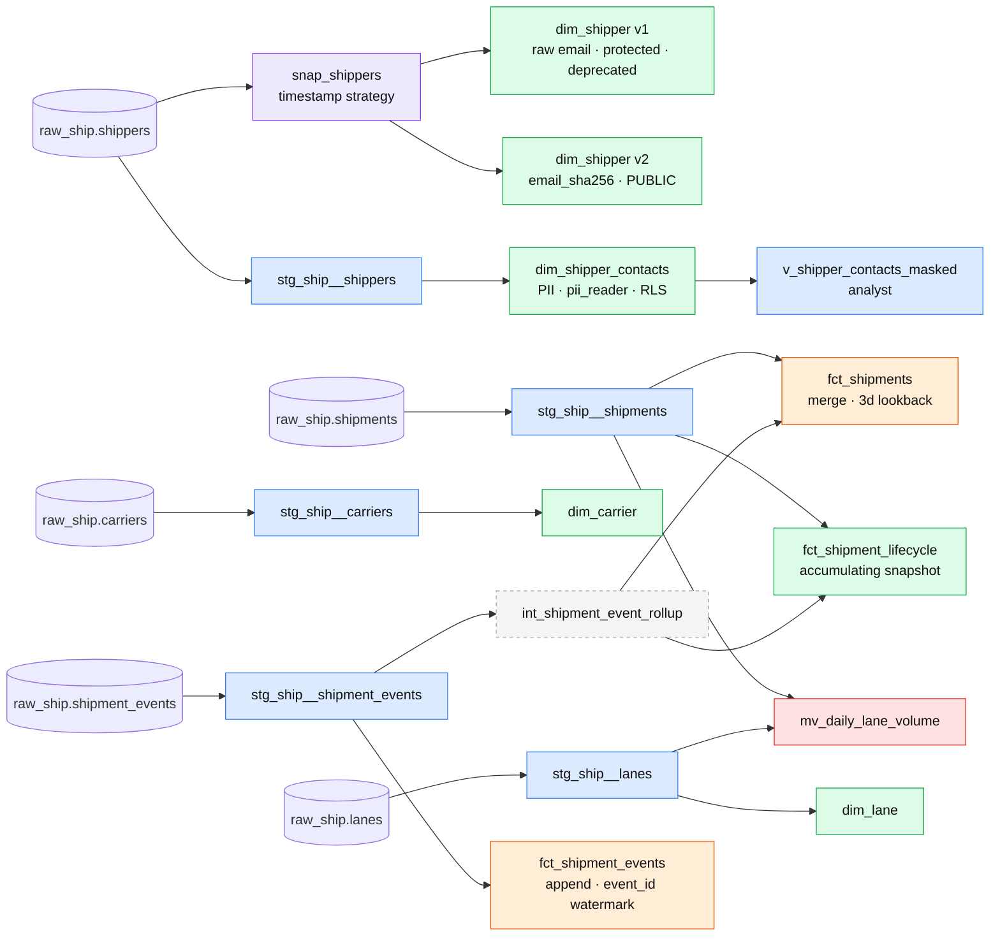
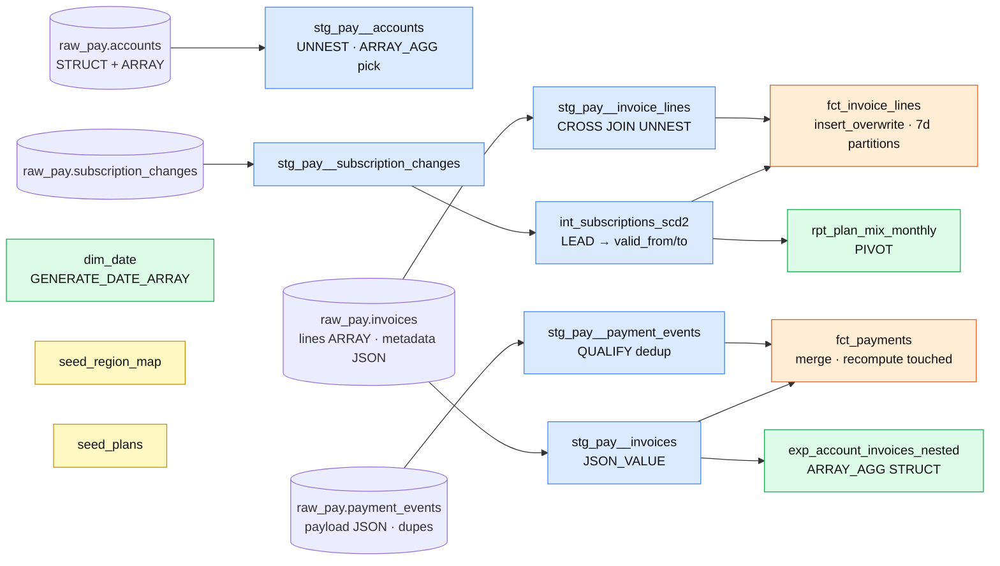

# dbt lineage (Phase 2)

Materializations: 🟦 view · ⬜ ephemeral · 🟩 table · 🟧 incremental · 🟪 snapshot · 🟥 materialized view

Access (Phase 3): staging/intermediate are `private`; public data products are `fct_shipments`, `fct_shipment_lifecycle`,
`dim_shipper` v2, `dim_carrier`, `dim_lane` (ship) and `fct_invoice_lines`, `fct_payments`, `dim_date` (udl). Everything else is `protected`.

## ruta_ship (Postgres ≈ Redshift)

## ruta_udl (BigQuery)

