# End-to-end lineage (generated)

Generated by `make lineage` (scripts/lineage_e2e.py) from both `manifest.json` files, the semantic manifest and
the exposures. Do not edit by hand. Staging/intermediate models are collapsed; sources are cylinders, consumers
are pills. The cross-cloud edge comes from the `udl_replication` exposure ↔ the `ship_replica` sources.

```mermaid
flowchart LR
  subgraph ruta_ship___Postgres___Redshift___sources["ruta_ship · Postgres = Redshift · sources"]
    source_ruta_ship_raw_ship_carriers[("raw_ship.carriers")]
    source_ruta_ship_raw_ship_lanes[("raw_ship.lanes")]
    source_ruta_ship_raw_ship_shipment_events[("raw_ship.shipment_events")]
    source_ruta_ship_raw_ship_shipments[("raw_ship.shipments")]
    source_ruta_ship_raw_ship_shippers[("raw_ship.shippers")]
  end
  subgraph ruta_ship___Postgres___Redshift___models["ruta_ship · Postgres = Redshift · models"]
    model_ruta_ship_dim_carrier["dim_carrier"]
    model_ruta_ship_dim_lane["dim_lane"]
    model_ruta_ship_dim_shipper_v2["dim_shipper"]
    model_ruta_ship_fct_shipment_lifecycle["fct_shipment_lifecycle"]
    model_ruta_ship_fct_shipments["fct_shipments"]
  end
  subgraph ruta_ship___Postgres___Redshift___exposures["ruta_ship · Postgres = Redshift · exposures"]
    exposure_ruta_ship_udl_replication(["udl_replication (UNLOAD → S3 → GCS → BQ)"])
  end
  subgraph ruta_udl___BigQuery___models["ruta_udl · BigQuery · models"]
    model_ruta_udl_dim_customer["dim_customer"]
    model_ruta_udl_dim_date["dim_date"]
    model_ruta_udl_fct_customer_monthly["fct_customer_monthly"]
    model_ruta_udl_fct_invoice_lines["fct_invoice_lines"]
    model_ruta_udl_fct_payments["fct_payments"]
    model_ruta_udl_fct_product_enrollment["fct_product_enrollment"]
    model_ruta_udl_fct_revenue["fct_revenue"]
    model_ruta_udl_fct_udl_shipments["fct_udl_shipments"]
    model_ruta_udl_kg_edges["kg_edges"]
    model_ruta_udl_kg_nodes["kg_nodes"]
  end
  subgraph ruta_udl___BigQuery___sources["ruta_udl · BigQuery · sources"]
    source_ruta_udl_raw_pay_accounts[("raw_pay.accounts")]
    source_ruta_udl_raw_pay_invoices[("raw_pay.invoices")]
    source_ruta_udl_raw_pay_payment_events[("raw_pay.payment_events")]
    source_ruta_udl_raw_pay_subscription_changes[("raw_pay.subscription_changes")]
    source_ruta_udl_ship_replica_dim_carrier[("ship_replica.dim_carrier")]
    source_ruta_udl_ship_replica_dim_lane[("ship_replica.dim_lane")]
    source_ruta_udl_ship_replica_dim_shipper[("ship_replica.dim_shipper")]
    source_ruta_udl_ship_replica_fct_shipment_lifecycle[("ship_replica.fct_shipment_lifecycle")]
    source_ruta_udl_ship_replica_fct_shipments[("ship_replica.fct_shipments")]
  end
  subgraph ruta_udl___BigQuery___exposures["ruta_udl · BigQuery · exposures"]
    exposure_ruta_udl_exec_dashboard(["exec_dashboard"])
    exposure_ruta_udl_metrics_mcp_server(["metrics_mcp_server"])
  end
  subgraph semantic_layer__MetricFlow_metrics_["semantic layer (MetricFlow metrics)"]
    metrics_cross_model__fct_customer_monthly___fct_revenue["cross-model: fct_customer_monthly + fct_revenue: revenue_per_customer"]
    metrics_cross_model__fct_product_enrollment___fct_udl_shipments["cross-model: fct_product_enrollment + fct_udl_shipments: ship_to_pay_conversion"]
    metrics_fct_customer_monthly["fct_customer_monthly: active_customers, churned_customers, customer_churn_rate, mrr, subscribers, subscription_cancellations, subscription_churn_rate"]
    metrics_fct_product_enrollment["fct_product_enrollment: pay_enrollments"]
    metrics_fct_revenue["fct_revenue: revenue_qoq_growth, total_revenue, trailing_90d_revenue"]
    metrics_fct_udl_shipments["fct_udl_shipments: booking_fees, delivered_shipments, first_bookings, gmv, on_time_delivery_rate, on_time_shipments, shipments, take_rate"]
  end
  exposure_ruta_ship_udl_replication --> source_ruta_udl_ship_replica_dim_carrier
  exposure_ruta_ship_udl_replication --> source_ruta_udl_ship_replica_dim_lane
  exposure_ruta_ship_udl_replication --> source_ruta_udl_ship_replica_dim_shipper
  exposure_ruta_ship_udl_replication --> source_ruta_udl_ship_replica_fct_shipment_lifecycle
  exposure_ruta_ship_udl_replication --> source_ruta_udl_ship_replica_fct_shipments
  metrics_cross_model__fct_customer_monthly___fct_revenue --> exposure_ruta_udl_metrics_mcp_server
  metrics_cross_model__fct_product_enrollment___fct_udl_shipments --> exposure_ruta_udl_metrics_mcp_server
  metrics_fct_customer_monthly --> exposure_ruta_udl_metrics_mcp_server
  metrics_fct_product_enrollment --> exposure_ruta_udl_metrics_mcp_server
  metrics_fct_revenue --> exposure_ruta_udl_metrics_mcp_server
  metrics_fct_udl_shipments --> exposure_ruta_udl_metrics_mcp_server
  model_ruta_ship_dim_carrier --> exposure_ruta_ship_udl_replication
  model_ruta_ship_dim_lane --> exposure_ruta_ship_udl_replication
  model_ruta_ship_dim_shipper_v2 --> exposure_ruta_ship_udl_replication
  model_ruta_ship_fct_shipment_lifecycle --> exposure_ruta_ship_udl_replication
  model_ruta_ship_fct_shipments --> exposure_ruta_ship_udl_replication
  model_ruta_udl_dim_customer --> exposure_ruta_udl_metrics_mcp_server
  model_ruta_udl_dim_customer --> model_ruta_udl_kg_edges
  model_ruta_udl_dim_customer --> model_ruta_udl_kg_nodes
  model_ruta_udl_dim_date --> exposure_ruta_udl_exec_dashboard
  model_ruta_udl_dim_date --> exposure_ruta_udl_metrics_mcp_server
  model_ruta_udl_fct_customer_monthly --> exposure_ruta_udl_metrics_mcp_server
  model_ruta_udl_fct_customer_monthly --> metrics_cross_model__fct_customer_monthly___fct_revenue
  model_ruta_udl_fct_customer_monthly --> metrics_fct_customer_monthly
  model_ruta_udl_fct_invoice_lines --> exposure_ruta_udl_exec_dashboard
  model_ruta_udl_fct_invoice_lines --> model_ruta_udl_fct_revenue
  model_ruta_udl_fct_payments --> exposure_ruta_udl_exec_dashboard
  model_ruta_udl_fct_payments --> exposure_ruta_udl_metrics_mcp_server
  model_ruta_udl_fct_payments --> model_ruta_udl_kg_edges
  model_ruta_udl_fct_payments --> model_ruta_udl_kg_nodes
  model_ruta_udl_fct_product_enrollment --> exposure_ruta_udl_metrics_mcp_server
  model_ruta_udl_fct_product_enrollment --> metrics_cross_model__fct_product_enrollment___fct_udl_shipments
  model_ruta_udl_fct_product_enrollment --> metrics_fct_product_enrollment
  model_ruta_udl_fct_product_enrollment --> model_ruta_udl_kg_edges
  model_ruta_udl_fct_product_enrollment --> model_ruta_udl_kg_nodes
  model_ruta_udl_fct_revenue --> exposure_ruta_udl_metrics_mcp_server
  model_ruta_udl_fct_revenue --> metrics_cross_model__fct_customer_monthly___fct_revenue
  model_ruta_udl_fct_revenue --> metrics_fct_revenue
  model_ruta_udl_fct_revenue --> model_ruta_udl_fct_customer_monthly
  model_ruta_udl_fct_udl_shipments --> exposure_ruta_udl_metrics_mcp_server
  model_ruta_udl_fct_udl_shipments --> metrics_cross_model__fct_product_enrollment___fct_udl_shipments
  model_ruta_udl_fct_udl_shipments --> metrics_fct_udl_shipments
  model_ruta_udl_kg_edges --> exposure_ruta_udl_metrics_mcp_server
  model_ruta_udl_kg_nodes --> exposure_ruta_udl_metrics_mcp_server
  source_ruta_ship_raw_ship_carriers --> model_ruta_ship_dim_carrier
  source_ruta_ship_raw_ship_lanes --> model_ruta_ship_dim_lane
  source_ruta_ship_raw_ship_shipment_events --> model_ruta_ship_fct_shipment_lifecycle
  source_ruta_ship_raw_ship_shipment_events --> model_ruta_ship_fct_shipments
  source_ruta_ship_raw_ship_shipments --> model_ruta_ship_fct_shipment_lifecycle
  source_ruta_ship_raw_ship_shipments --> model_ruta_ship_fct_shipments
  source_ruta_ship_raw_ship_shippers --> model_ruta_ship_dim_shipper_v2
  source_ruta_udl_raw_pay_accounts --> model_ruta_udl_dim_customer
  source_ruta_udl_raw_pay_accounts --> model_ruta_udl_fct_customer_monthly
  source_ruta_udl_raw_pay_accounts --> model_ruta_udl_fct_product_enrollment
  source_ruta_udl_raw_pay_accounts --> model_ruta_udl_fct_revenue
  source_ruta_udl_raw_pay_accounts --> model_ruta_udl_fct_udl_shipments
  source_ruta_udl_raw_pay_accounts --> model_ruta_udl_kg_edges
  source_ruta_udl_raw_pay_invoices --> model_ruta_udl_fct_invoice_lines
  source_ruta_udl_raw_pay_invoices --> model_ruta_udl_fct_payments
  source_ruta_udl_raw_pay_invoices --> model_ruta_udl_kg_edges
  source_ruta_udl_raw_pay_invoices --> model_ruta_udl_kg_nodes
  source_ruta_udl_raw_pay_payment_events --> model_ruta_udl_fct_payments
  source_ruta_udl_raw_pay_subscription_changes --> exposure_ruta_udl_exec_dashboard
  source_ruta_udl_raw_pay_subscription_changes --> model_ruta_udl_dim_customer
  source_ruta_udl_raw_pay_subscription_changes --> model_ruta_udl_fct_customer_monthly
  source_ruta_udl_raw_pay_subscription_changes --> model_ruta_udl_fct_invoice_lines
  source_ruta_udl_raw_pay_subscription_changes --> model_ruta_udl_kg_edges
  source_ruta_udl_ship_replica_dim_carrier --> model_ruta_udl_kg_nodes
  source_ruta_udl_ship_replica_dim_lane --> model_ruta_udl_kg_edges
  source_ruta_udl_ship_replica_dim_lane --> model_ruta_udl_kg_nodes
  source_ruta_udl_ship_replica_dim_shipper --> model_ruta_udl_dim_customer
  source_ruta_udl_ship_replica_dim_shipper --> model_ruta_udl_fct_customer_monthly
  source_ruta_udl_ship_replica_dim_shipper --> model_ruta_udl_fct_product_enrollment
  source_ruta_udl_ship_replica_dim_shipper --> model_ruta_udl_fct_revenue
  source_ruta_udl_ship_replica_dim_shipper --> model_ruta_udl_fct_udl_shipments
  source_ruta_udl_ship_replica_dim_shipper --> model_ruta_udl_kg_edges
  source_ruta_udl_ship_replica_fct_shipments --> model_ruta_udl_fct_customer_monthly
  source_ruta_udl_ship_replica_fct_shipments --> model_ruta_udl_fct_revenue
  source_ruta_udl_ship_replica_fct_shipments --> model_ruta_udl_fct_udl_shipments
  source_ruta_udl_ship_replica_fct_shipments --> model_ruta_udl_kg_edges
  source_ruta_udl_ship_replica_fct_shipments --> model_ruta_udl_kg_nodes
  agent([agent/ask.py · Claude via MCP])
  exposure_ruta_udl_metrics_mcp_server --> agent
```

