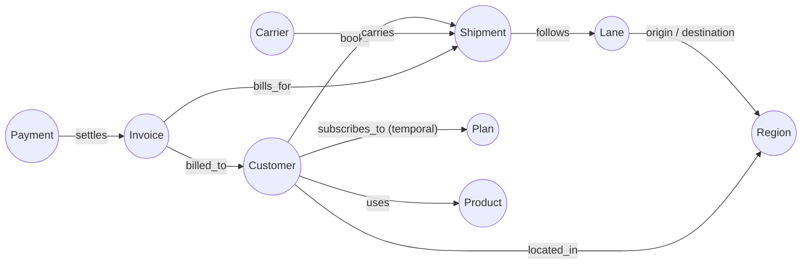

# Ontology (draft, finalized in Phase 4)

Classes are business concepts, not tables. Each maps to a public model (`maps_to`).

Synonyms (feed the NL agent): Customer ≈ client, account, shipper, cliente · Shipment ≈ load,
booking, envío · Invoice ≈ bill, factura · Plan ≈ tier, subscription.
