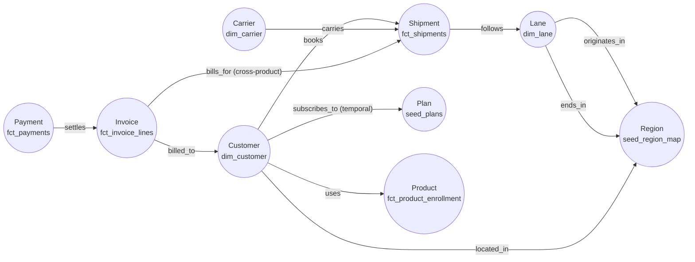

# Ontology (Phase 4, final)

Source of truth: [`ontology/ruta_ontology.yml`](../../ontology/ruta_ontology.yml). Classes are business concepts, not
tables; each `maps_to` a public data product (governance rule R6) and generates KG nodes. Relations generate KG edges.

| Class | Synonyms (feed the NL agent) |
|---|---|
| Customer | client, account, shipper, merchant, cliente, cuenta, empresa |
| Shipment | load, booking, envío, carga |
| Carrier | transporter, trucking company, transportista |
| Lane | route, corridor, ruta |
| Region | territory, market, región, zona |
| Invoice | bill, factura |
| Payment | collection, cobro, pago |
| Plan | tier, subscription, package |
| Product | line of business, producto |

KG size: ~122k nodes, ~270k edges (`udl_kg.kg_nodes`, `udl_kg.kg_edges`).
