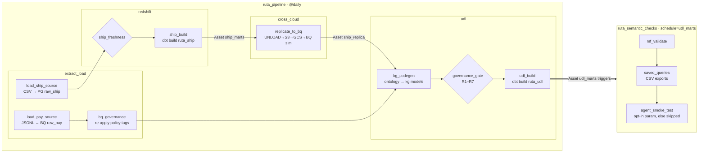

# Pipeline flow (Airflow DAGs, Phase 7)

Two DAGs in [airflow/dags/ruta_pipeline.py](../../airflow/dags/ruta_pipeline.py), linked by an Asset (data-aware
scheduling). Diamonds are quality gates (retries=0, fail before spending). Table-level lineage:
[end-to-end-lineage.md](end-to-end-lineage.md).

