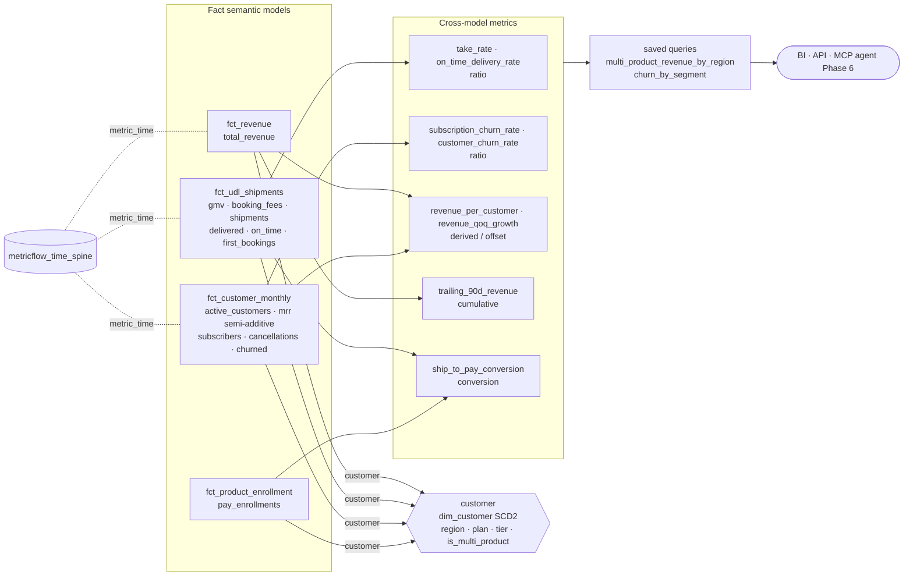

# Semantic layer (Phase 5)

Entities are the join graph. Facts point to `customer`; `dim_customer` is an SCD2 semantic model (natural entity +
validity window), so MetricFlow joins each fact row to the customer version valid at `metric_time`.

How a cross-model query compiles (`--explain`): each metric is aggregated **in its own subquery** at the requested
grain (with the SCD2 as-of join), then the subqueries are FULL OUTER JOINed on the group-by keys. No fan-out.
