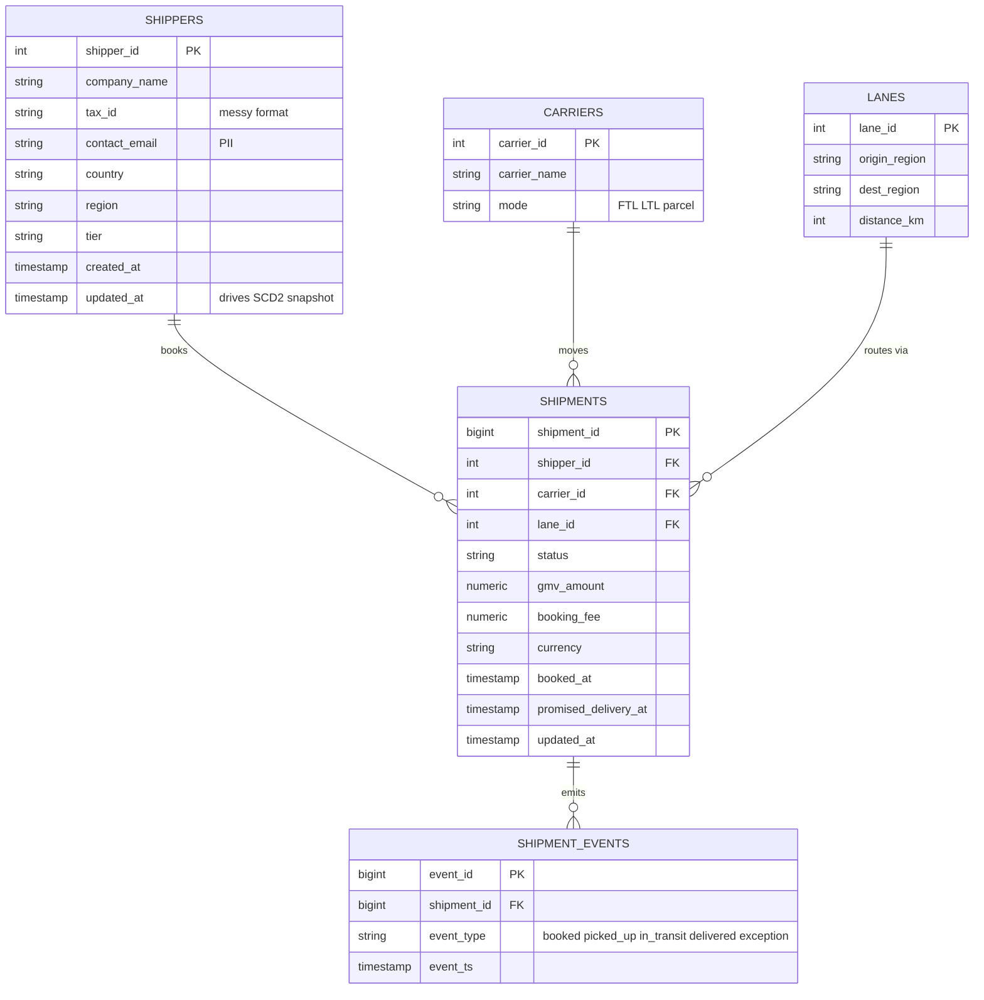
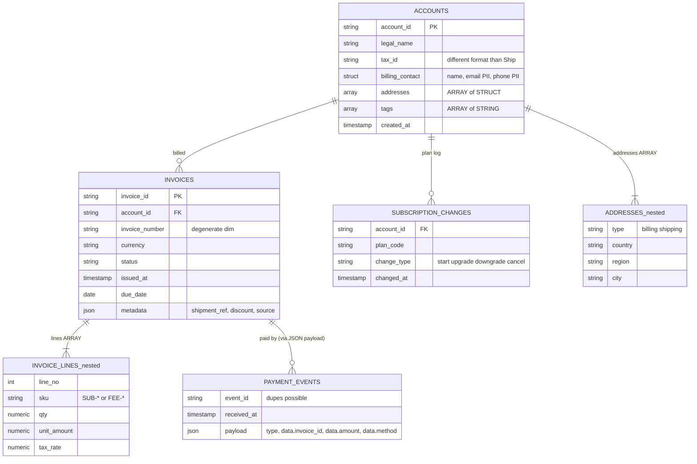

# Source ERDs (raw layer)

## RutaShip: Postgres ≈ Redshift (`raw_ship`, relational / 3NF)

## RutaPay: BigQuery (`raw_pay`, nested / document-style)

Nested fields are shown as separate "entities" for readability. In BQ they live *inside* the parent row.

> **Cross-product links:** `INVOICES.metadata.shipment_ref` → `SHIPMENTS.shipment_id` (when Pay bills a
> Ship booking), and the *real-world* company behind `SHIPPERS` / `ACCOUNTS` (resolved in Phase 4).
