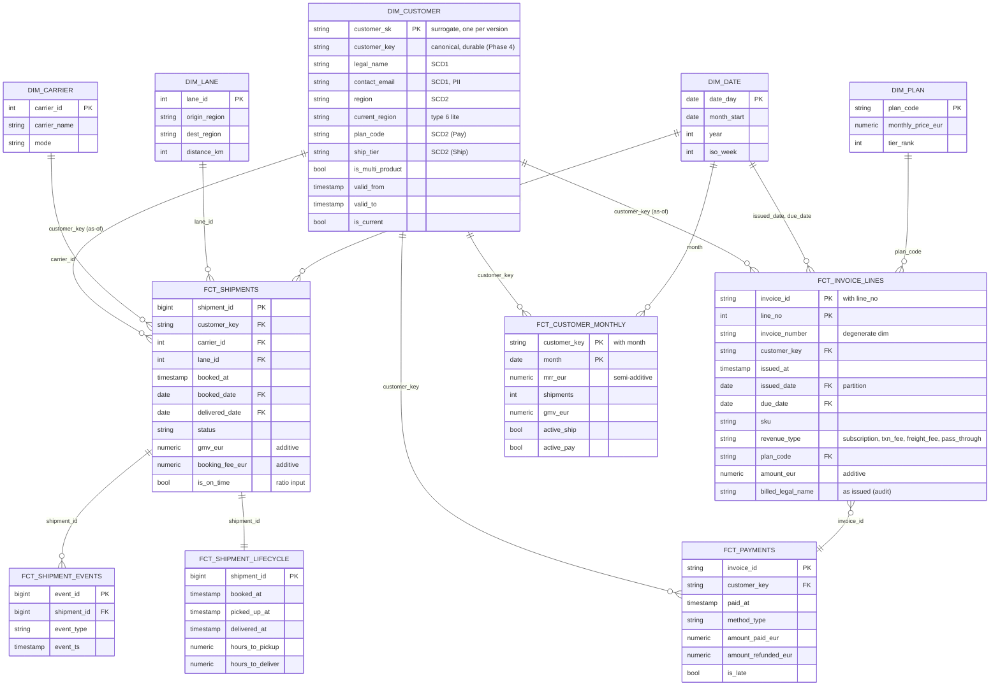

# Star schema: UDL marts (BigQuery)

Facts carry the durable `customer_key`. They join to the SCD2 `dim_customer` **as of** the event time
(`valid_from <= event_ts < valid_to`). `dim_date` plays several roles.

